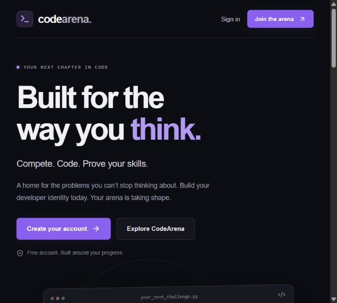

# Milestone 1 implementation and verification

Verified locally on 18 November 2026 (Asia/Calcutta).

## Delivered

- Architecture, phased implementation plan and separated monorepo folders.
- Next.js 16 App Router, React 19, TypeScript, Tailwind v4, shadcn-style button primitive, React Hook Form/Zod and TanStack Query.
- Responsive dark interface: landing page, account flows, authenticated account overview, profile onboarding and security settings. Future modules are labeled as planned.
- FastAPI versioned routes, explicit request/response models and generated OpenAPI documentation.
- PostgreSQL UUID identity/session/token/audit entities and an applied Alembic migration.
- Argon2 passwords; email verification; login/logout; expiring, revocable JWT cookie sessions; session listing/revocation/rotation; password recovery and profile persistence.
- Origin validation for mutations, HTTP-only SameSite cookies, production Secure-cookie switch, Redis rate limits and server-side administrator permission checks.
- GitHub OAuth adapter with state validation, verified primary email requirement, stable provider subject and rejection of silent account linking.
- Mailpit SMTP development inbox, environment initialization, separate startup scripts, VS Code tasks and Git initialization. No remote or commit was created.
- Dependency lockfiles, local checks and a GitHub Actions workflow for future pushes/PRs.

## Verification evidence

Story: register in the browser → Next.js `/api/v1` proxy → FastAPI → PostgreSQL and Redis → Mailpit verification → sign in → persist profile → manage sessions → sign out.

| Boundary | Result | Evidence |
| --- | --- | --- |
| Browser → frontend | Passed | Registration, verification, login, profile and security pages rendered; no captured browser warning/error logs. |
| Frontend → API | Passed | Proxied registration 201, verification/login 200, authenticated profile PATCH 200. |
| API → persistence | Passed | Profile values survived a full browser reload; migration consistency check found no new operations. |
| Email → verification | Passed | Actual local SMTP email arrived in Mailpit; its link verified the account in the browser. |
| Session → UI | Passed | Renewal updated expiry and announced success; logout returned to login; reopening workspace while signed out redirected to login. |
| Full-stack recovery | Passed | Repeatable HTTP smoke test verified SMTP recovery, password update, old-session revocation, new login and logout. |
| Backend boundaries | Passed | **15 tests**, using migrations in an isolated random PostgreSQL schema; includes real Redis counter/expiry check. |
| Frontend behavior | Passed | **3 tests** covering validation/privileged-role rejection, button behavior, form errors and password visibility. |
| Production compilation | Passed | Next.js production build and TypeScript validation. |
| Dependency checks | Passed | npm audit: **0 vulnerabilities**; pip check: no broken requirements. This is not a Python vulnerability audit. |
| Configuration | Passed | Compose validates; all PowerShell scripts parse; secrets, virtual environment, node_modules and build output are ignored by Git. |

Browser layout was inspected in the in-app browser at its approximately 706px-wide viewport with the single-column breakpoint active. The viewport override did not change the browser's measured dimensions, so exact 390px and desktop-width visual checks are not claimed. CSS includes narrower and wider breakpoints; those specific device sizes remain to be checked in a resizable browser.

The CI workflow is configured but has not run on GitHub. The backend dependencies currently emit HTTPX migration deprecation notices in Authlib and Starlette; tests pass, and these are not runtime failures.

## External dependencies and limits

- Live GitHub OAuth remains unverified without registered provider credentials. Adapter behavior and invalid callback state are covered by automated tests; this is not a substitute for a real provider round trip.
- Mailpit captures local email. Production SMTP delivery, retries and a durable mail outbox remain to be configured/hardened.
- Authentication roles are a minimal foundation. Organization membership, permission catalogs, tenant-scoped resources and role-specific product dashboards belong to Milestone 2. No tenant-isolation claim is made for resources that do not yet exist.
- Challenge evaluation, competitions, AI, collaboration, assessments, college management and billing are pending Milestones 3–8. No arbitrary code runner is enabled.
- Production security/load review, infrastructure hardening, deployment/rollback, backup and restore are pending Milestone 9. This is not a commercial-release readiness claim.
- Local QA creates synthetic accounts and audit records. Unit/integration fixtures clean only their own temporary schema. No default product credentials or fake activity statistics were introduced.

## Reproduce and continue

Use the commands in the root README, or run the VS Code task **CodeArena: run** to launch both development servers. Preview servers used for verification were stopped after testing; infrastructure containers remain available. The next implementation boundary is Milestone 2.

